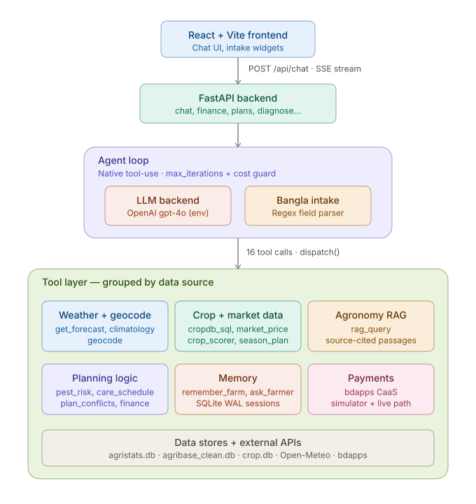

# Capabilities: what the advisor does, by tier

Moved from the README on 2026-11-10 (unchanged except paths). Tiers follow the hackathon brief (`docs/product/competition.md`).

## Tier coverage

Per the competition brief's tiered scope. "Done" means it runs end to end
through the live agent and UI, not just that the code exists.

### Tier 0 — Core (required)

| # | Capability | Status | Where |
|---|---|---|---|
| 1 | Conversational intake | **Done** | `ask_farmer` tool + `backend/agent/prompts.py` gap-detection; one missing field at a time via typed widgets (`InputRequest.jsx`) |
| 2 | Live weather grounding | **Done** | `get_forecast` (16-day, Open-Meteo, `source_type=forecast`) and `get_climatology` (historical normals, `source_type=climatology`) — real HTTP calls, never invented |
| 3 | Crop recommendation | **Done** | `crop_scorer` tool, deterministic, ranks the 5 supported crops on season/soil/water/climate/district track record/profit; `degraded` list discloses any missing evidence, relayed to the farmer before any ranking is shown |
| 4 | Season plan | **Done** | `season_plan` tool — dated, source-cited calendar (sowing → fertilizer → irrigation → weeding → harvest) for the confirmed crop and date; the LLM never invents a date |
| 5 | Financial projection | **Done** | `finance_projection` tool — itemised costs, yield (with uncertainty band), revenue, net profit, ROI, break-even, 3 scenarios; refuses rather than estimates if a price/cost citation is missing |
| 6 | Explained reasoning | **Done** | Every tool result carries `source_id`/`source_title`/`locator`/`confidence`; the agent narrates only what a tool returned, never its own recall |
| 7 | Knowledge base with RAG | **Done** | Two separate, real mechanisms, not one — see "Two knowledge sources" below. `rag_query` retrieves from 52 cited passages; `crop_scorer` reads a separate hand-curated facts table directly. Called before every crop recommendation and again for the chosen crop's calendar |
| 8 | Visible agent trace | **Done** | Every tool call emits `tool_call`/`tool_result` SSE events; the "কাজের চিত্র" (work diagram) panel (`GraphPanel.jsx`) renders them live as a Bangla-labeled provenance graph — see "What the trace panel actually shows" below for exactly what it does and doesn't expose |

### Tier 1 — Advanced

| Capability | Status | Where |
|---|---|---|
| Persistent memory | **Done** | `remember_farm` tool + `backend/memory/store.py` (`farms` table); farm profile is keyed by `farm_id` and re-read on every turn and every crop-sidebar load, so a returning session doesn't repeat intake |
| Proactive, weather-triggered advice | **Done** | `check_plan_conflicts` tool compares the saved plan's weather-dependent tasks against the live forecast and persists traceable alerts; surfaced in `AlertPanel.jsx` ("আমার প্ল্যান চেক করুন") |
| Fertilizer and irrigation scheduler | **Done** | `care_schedule` tool — pulls fertilizer/irrigation tasks from the saved `season_plan`, with live forecast context when a task falls inside the 16-day horizon. Doses/timing are cited, never computed |
| Pest and disease risk | **Done** | `pest_risk` tool (`backend/tools/pest_risk.py`) — deterministic crop x growth-stage x weather rules for 11 named pests/diseases across the 5 crops. Stage windows are days-after-sowing from the confirmed planting date; triggers are evaluated against the live 16-day forecast including daily mean humidity. Prevention/treatment text and doses come verbatim from the 14 cited pest/disease KB passages. **Treatment cost is reported as unavailable, not estimated** — no citable Tk price for any pesticide or fungicide exists in our sources (see the real-vs-mock table). A risk whose window opens beyond the forecast horizon returns `status: upcoming` with no level rather than an invented prediction |
| Scenario simulation | **Done** | `simulate_budget` tool — re-runs deterministic ranking + finance under a changed budget ("what if my budget drops 30%?"); the server computes the delta, never the model |

### Tier 2 — Ambitious (bonus)

| Capability | Status | Notes |
|---|---|---|
| Marketplace / supplier comparison | **Done (FutureMakers round), with demo dealers** | `find_inputs` ranks dealers by price, distance, stock and trust, deterministically; see "New in the FutureMakers round" |
| Market price intelligence (sell-now/wait) | **Done** | `market_price` tool (`backend/tools/market_price.py`) over `agristats.db :: fact_prices` — 83,097 BBS Yearbook monthly wholesale rows, 2007-08 to 2025. Returns the 12-month historical price curve in Tk/kg plus a deterministic sell-now / consider-storing reading. Three constraints are structural, not disclaimers: it is labelled `basis: historical_pattern` and `not_a_forecast` (the same discipline `weather.py` applies to climatology); it is labelled `is_farm_gate: false`, because these are wholesale prices and revenue may only come from the cited farm-gate table in `data/prices.md`; and `storage_cost_bdt` is null because no source in this project prices storage or spoilage, so a "store" reading is an upside **before** costs. See "Why retail prices cannot become revenue" below |
| Plant disease detection from images | **Done, with a stated limitation** | `POST /api/diagnose/image` runs `linkanjarad/mobilenet_v2_1.0_224-plant-disease-identification` (MobileNetV2 fine-tuned on PlantVillage, 38 classes) locally on CPU — no image leaves the machine. Camera button in the composer. **Two limitations ship inside every response, not as a footnote:** (1) of our five crops, PlantVillage's label set covers **potato only** — rice, mustard and lentil are absent from it entirely, and a closed-set classifier will still return a confident label for them, so every result reports `is_supported_crop` and an out-of-scope warning in Bangla when the predicted crop is not one we advise on; (2) PlantVillage is **laboratory imagery** (single detached leaves, uniform background), so accuracy on a real field photo is materially lower than the headline benchmark — the result says so and tells the farmer to treat it as a second opinion. Dependencies are **optional** (`backend/requirements-vision.txt`, ~200 MB of CPU torch): without them the backend still starts, `GET /api/diagnose/status` reports `available: false`, and the UI hides the camera button rather than offering an upload that will fail |
| bdapps Payment Gateway Integration | **Done, simulator mode.** The payments module (`backend/payments/`: `client.py`, `msisdn.py`, `service.py`, `simulator.py`) is now wired end to end: a `কেনাকাটা` tab appears when a basket exists, and runs quote -> confirmation -> charge -> Bangla SMS receipt through `POST /api/checkout/quote` and `POST /api/checkout`. The confirmation gate is enforced **server-side** — a charge without a registered, unexpired quote is refused with 409, so it is a guarantee rather than a UI convention. The mode badge reads whatever `GET /api/checkout/mode` reports off the client object actually in use, and says `unknown` if the server did not answer, because guessing "simulator" in the wrong direction is exactly the failure CLAUDE.md rule 13 exists to prevent. **No real money moves.** The basket is derived from the agent's own cited input-cost lines, and only from purchasable ones — BBS's boro/aman/potato cost rows are a single aggregate figure in `ha`, so those crops get no checkout rather than a fabricated product list. |
| Bengali interaction and voice | **Done** | Bangla by default throughout. A settings panel (`SettingsModal.jsx`) switches the UI **and the agent's replies** between Bangla and English (the choice is sent on `/api/chat` and injected as a system note), and sets text size (small/medium/large) for sunlight and low vision. **Dictation** records with `MediaRecorder` and transcribes server-side via `POST /api/transcribe` using OpenAI `gpt-4o-transcribe`. **Read-aloud** stays browser-native (`speechSynthesis`) with a chooseable voice and speed. See the voice note below for why dictation is not browser-native |

If you build only Tier 0 and it runs cleanly, per the brief that's a complete,
competitive submission — Tier 1 above it is where this build differentiates.

## New in the FutureMakers round (September 2026)

Only about 1 in 4 rural mobile users in Bangladesh owns a smartphone (GSMA, 2024),
so the advisor now has four doors onto the same agent, the same farm memory and the
same tools:

| Door | Phone | Status | Where |
|---|---|---|---|
| Web app | smartphone | **Working** (the July build) | `frontend/`, `POST /api/chat` |
| SMS | any | **Verified on real SIMs** (2026-09-29): SMS in and out through an Android phone over USB, incl. the full SMS menu → crop-problem diagnosis; loop-guarded | `backend/channels/sms.py`, `flows.py`; `POST /api/channels/sms/smsgate` |
| Missed call → SMS | any | **Working in the simulator; ADB bridge built, not yet run on a device** | `backend/channels/bridge/adb.py` |
| USSD `*code#` | any | **Working in the simulator** (a real short code needs operator provisioning); bdapps request/response shape implemented. Every screen fits one Bangla USSD page (80 UCS-2 units, tested over all reachable screens); 9 = more, 0 = back everywhere; a dropped session is offered back on redial | `backend/channels/ussd.py`; `POST /api/channels/ussd/bdapps` |
| Crop-problem menu (USSD 2) | any | **Working in the simulator.** Crop → stage → where → what it looks like → how much, by digits; a deterministic KB-bounded table names the likely causes, the SMS answer is a template (doses only as the source states them, scaled to the farmer's bigha by `units.py`); no KB coverage → referral to SAAO / 16123. Reports aggregate by district as a pest signal | `backend/kb/triage.py`, `backend/channels/triage_menu.py`; `docs/channels/CHANNELS_RESEARCH.md` §4 |
| Voice call | any | **Real calls work through Windows Phone Link** (bridge + Voicemeeter, no root, no modem). First real calls 2026-11-10 on a Motorola Edge 50: greeting heard by the caller, caller's question transcribed and answered. **Open:** on that phone the call must be answered in Phone Link by hand (auto-answer over ADB leaves audio on the handset), and the post-call SMS needs the SMS Gateway app. Setup: `docs/channels/PHONE_SETUP.md` | `backend/channels/voice/`, `phonelink.py` |
| Proactive alerts by SMS | any | **Working** (opt-in loop) | `backend/channels/alerts_job.py` |
| SMS menu mode (text মেনু) | any | **Verified on real SIMs** — the USSD menu over plain SMS, so button-phone menus work today without a short code | `backend/channels/sms_menu.py` |
| Keypad on the hotline | any | **Working in the browser emulator; DTMF detection tested on synthetic tones (noise, 8 kHz), not yet on a real call** | `backend/channels/voice/audio.py` (`DtmfDetector`), `voice/ivr.py` |

And two marketplaces that turn advice into action:

| Marketplace | Status | Where |
|---|---|---|
| **Input marketplace** — the agent's `find_inputs` tool ranks nearby dealers (price 40, distance 30, stock 15, trust 15; no paid placement); order on the web, USSD menu 5 or SMS; the dealer confirms by SMS; commission paid by the dealer | **Working, with demo dealers** (labelled ডেমো everywhere) | `backend/market/inputs.py`, `ranking.py`; `#/market`, `#/dealer` |
| **Produce marketplace** — the farmer lists the harvest (`বিক্রি আলু 500 কেজি 22 টাকা`), sees a cited price guide, buyers offer, the farmer accepts with one SMS reply; the platform fee is paid by the buyer | **Working, with demo buyers** | `backend/market/produce.py`; `#/market`, `#/buyer` |

Try it: `#/app` is the web advisor (sign in, or continue as a guest; previous chats in the
sidebar), `#/monitor` replays every phone conversation into the provenance graph, `#/market`
is the farmer's marketplace. The browser button-phone emulator (`#/phone`) was removed from
the site on 2026-09-30; the emulator API routes remain for tests and scripts. Everything
simulated is labelled **সিমুলেটর** or **ডেমো**.

## What never changed

Every channel runs the same agent under the same rules: numbers come only from tool
results (the LLM never does arithmetic or ranks — crops *or* dealers), every price
carries provenance, and a missing source is said out loud. SMS and USSD numbers are
inserted by templates from tool payloads (`backend/channels/sms_text.py`: the ranking
and the plan/cost summary), never written by the model — the agent's SMS prose is told
to carry no figures. And the agent may not plan on farm facts the farmer never gave:
`backend/agent/intake_guard.py` refuses `crop_scorer` / `finance_projection` /
`season_plan` / `simulate_budget` when the district, soil, water or season in their
parameters is not in the farmer's messages or saved profile (found live: a garbled SMS
had produced a ranking for an invented district). Phone numbers are stored in one table (`contacts`); everything
else keys on a salted hash, and traces show the last 3 digits only.

## Tool choices (researched September 2026)

| Need | Choice | Why |
|---|---|---|
| Bangla speech-to-text | **Sarvam** (`saaras:v3`), OpenAI `gpt-4o-transcribe` as fallback | A Sep-2026 Bangla benchmark over 1,001 clips ([riverbornai](https://github.com/riverbornai/bangla-speech-to-text-benchmark/releases/tag/v1.0.0)) measured Sarvam at 6.9% CER vs 28.7% for `gpt-4o-transcribe`. **Verified here 2026-09-28:** Sarvam TTS → Sarvam STT on the July district-name sentence ("আমার দিনাজপুরে এক বিঘা জমি আছে…") came back exact, also after squeezing the audio to 8 kHz telephone band (TTS 2.2 s, STT 1.2 s). That is synthetic speech; real farmers' voices are the next test |
| Bangla text-to-speech | Sarvam Bulbul, Azure `bn-BD` (Dhaka accent) or OpenAI — a config switch | To be chosen by a listening test |
| SMS gateway (pilot) | [SMSGate](https://github.com/capcom6/android-sms-gateway) on an Android phone (Apache-2.0, local-server REST + signed webhooks) | Free, real SMS |
| Real phone calls (pilot) | **Windows Phone Link + Voicemeeter** (both free); a Quectel EC2x USB modem is the later, laptop-free option | An Android phone cannot hand call audio to an app without root, but Phone Link makes the laptop the phone's Bluetooth hands-free, and Voicemeeter turns its speaker/mic into cables the bridge can use |
| USSD emulator, marketplace | Own code | Existing USSD simulators speak other operators' formats; a separate commerce stack (e.g. Medusa) would duplicate our Decimal finance engine |

## Agent tools

**Agent tools** (registered in `backend/agent/tools_spec.py`, dispatched by name; every
call emits a traced `tool_call`/`tool_result` pair — 17 tools total; the table
lists the original core, plus `pest_risk`, `market_price` and `find_inputs`):

| Tool | Does |
|---|---|
| `ask_farmer` | Asks the farmer one missing intake field at a time, with the right input widget |
| `geocode` | Resolves a place/district name to coordinates (Open-Meteo geocoder + 64-district fallback) |
| `get_forecast` | 16-day weather forecast for coordinates |
| `get_climatology` | Historical monthly normals for coordinates |
| `rag_query` | Source-cited agronomy passages from the 52-passage curated corpus |
| `cropdb_sql` | District yield history, Holt yield projection, and yield track record |
| `agri_inputs` | Historic BBS Chapter 7 seed/fertilizer/pesticide/wage/irrigation reference facts |
| `crop_scorer` | Deterministic ranking of the 5 supported crops for a farm profile |
| `finance_projection` | Costed 3-scenario financial projection for one crop |
| `season_plan` | Dated, source-cited task calendar for a confirmed crop and date |
| `check_plan_conflicts` | Compares a saved plan's weather-dependent tasks against the live forecast |
| `care_schedule` | Fertilizer/irrigation tasks due from a saved plan, with forecast context |
| `simulate_budget` | Re-runs ranking + finance under a changed budget |
| `remember_farm` | Persists the confirmed farm profile for future turns/sessions |
| `pest_risk` | Deterministic crop × growth-stage × forecast pest/disease risk, cited treatments |
| `market_price` | Historical wholesale price pattern + sell-now / consider-storing reading |
| `find_inputs` | Ranked nearby dealer offers for one input, with dated listing provenance |

The agent streams Server-Sent Events; every tool call emits `tool_call` and
`tool_result` into a live trace, rendered as a Bangla-labeled provenance graph
(`GraphPanel.jsx` — see "What the trace panel actually shows" above for exactly
what it exposes). Redaction happens in the event constructors *and* again at
the serializer: passwords, app ids, keys and tokens become `***`; phone
numbers keep their last three digits so a human can still confirm which SIM
was involved — because a leaked credential in a judge-facing panel is not a
recoverable mistake.

## Competition rules compliance

All application code — the parser, the Holt fitting, the finance engine, the agent —
was written and run during the event. Derived artifacts (`data/crop.db`, the
projections) are generated in-event and carry timestamps plus a git sha. Raw public
yearbook PDFs are not committed (234 MB); they are public documents hosted separately.
Pre-cached third-party models and wheels are used but not authored here.

## Horizon 2

`crop.db`'s long/tidy, provenance-per-row design generalises to an `observations`
table covering all 146 crops, livestock, fisheries, prices, weather and disaster loss
across all 14 yearbook editions (2012–2025) — turning AgriSense from one farmer's
advisor into a citable agricultural intelligence layer for Bangladesh, under the same
rule throughout: every number carries its page.
